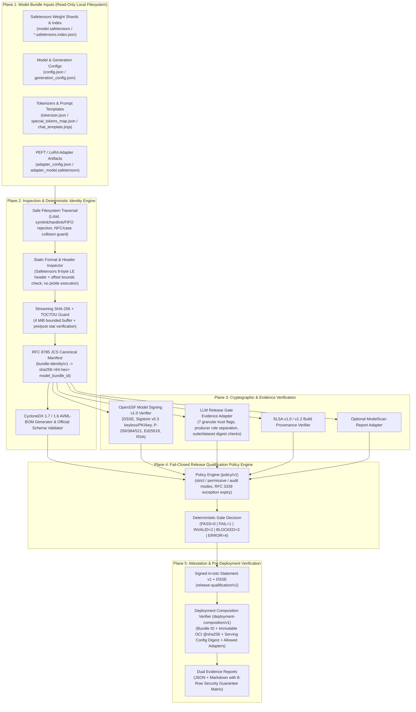

<div align="center">

# 🛡️ AI Model Provenance Gate

**Go-Native AI Model Artifact Identity, CycloneDX 1.7 AI/ML-BOM, OpenSSF Model Signing v1.0 & Release Qualification Gate**

[](https://github.com/devenes/ai-model-provenance-gate/actions/workflows/ci.yml)
[](https://github.com/devenes/ai-model-provenance-gate/actions/workflows/release.yml)
[](go.mod)
[](docs/standards/cyclonedx-mlbom.md)
[-0969da)](docs/standards/openssf-model-signing.md)
[](docs/standards/in-toto-and-slsa.md)
[](LICENSE)

[**Overview**](#1-overview) •
[**Architecture**](#5-architecture-overview) •
[**Supported Standards**](#6-supported-standards-and-specifications) •
[**Installation**](#7-installation) •
[**60-Second Quickstart**](#8-60-second-quickstart) •
[**CLI Reference**](#9-cli-command-reference) •
[**Tampering Demo**](#10-end-to-end-tampering-demonstration)

</div>

---

## 1. Overview

`ai-model-provenance-gate` (`ai-model-provenance`) verifies whether a local AI model bundle—weights, configuration files, tokenizers, chat templates, and PEFT/LoRA adapters—is cryptographically identical to the model bundle that passed behavioral evaluation, was signed by a trusted model producer, and received release qualification approval.

It runs entirely on CPU in bounded memory using streaming SHA-256 hashing and static binary header inspection. No GPU, Python runtime, model-serving engine, Kubernetes cluster, or cloud account is required.

---

## 2. Why This Project Exists

Modern LLM and AI release pipelines routinely suffer from an **artifact-to-evidence gap**:

1. **Mutable Model Directories & Registry Tags:** Behavioral evaluations run against a directory path or model name (`llama-3-support-v1`), while deployment pulls from a mutable storage path where `tokenizer.json`, `chat_template.jinja`, `adapter_model.safetensors`, or a weight shard can be silently replaced.
2. **Unbound Evaluation Reports:** A passing behavioral evaluation report (`PASS`) proves only that *some* candidate passed a test suite unless the report is cryptographically bound to the exact immutable model bundle digest (`model_bundle_id`) and signed by a trusted evaluation producer.
3. **Opaque Adapter & Runtime Composition:** Deploying a verified base model alongside an unverified LoRA adapter, a modified serving configuration, or a mutable container image tag (`:latest`) invalidates the guarantees established during qualification.

`ai-model-provenance-gate` closes this gap with deterministic, offline-verifiable cryptographic evidence.

---

## 3. Core Product Guarantee

> **The exact model artifact that passed trusted evaluation, was signed by an authorized producer, and received release qualification approval must be the exact artifact verified for deployment.**

```text
Local Model Bundle
  -> Deterministic Bundle Identity (bundle-identity/v1)
  -> CycloneDX 1.7 AI/ML-BOM + OpenSSF Model Signing v1.0 Verification
  -> LLM Release Gate Evidence Binding + Policy Qualification
  -> Signed in-toto Release Qualification Attestation
  -> Pre-Deployment Composition Verification (PASS / FAIL / BLOCKED)
```

---

## 4. Portfolio Fit

`ai-model-provenance-gate` is the third pillar of a cohesive AI platform engineering and security portfolio:

| Project | Layer | Primary Responsibility |
|---|---|---|
| [**`ai-platform-conformance-kit`**](https://github.com/devenes/ai-platform-conformance-kit) | Infrastructure & Platform | Verifies whether the underlying Kubernetes/compute platform is conformant and ready to run AI workloads. |
| [**`llm-release-gate`**](https://github.com/devenes/llm-release-gate) | Behavioral & Regression | Evaluates whether an LLM application or model behaves acceptably against golden suites, graders, and regression baselines. |
| [**`ai-model-provenance-gate`**](https://github.com/devenes/ai-model-provenance-gate) | **Artifact Identity, Provenance & Release Qualification** | Verifies that the **exact model artifact** that passed evaluation, provenance checks, and signing is the exact artifact approved and composed for deployment. |

---

## 5. Architecture Overview



Detailed architecture documents:
- [`docs/architecture/overview.md`](docs/architecture/overview.md)
- [`docs/architecture/artifact-identity.md`](docs/architecture/artifact-identity.md)
- [`docs/architecture/trust-model.md`](docs/architecture/trust-model.md)
- [`docs/architecture/data-flow.md`](docs/architecture/data-flow.md)
- [`docs/architecture/implementation-decisions.md`](docs/architecture/implementation-decisions.md)

---

## 6. Supported Standards and Specifications

| Standard / Specification | Version / URI | Implementation Details |
|---|---|---|
| **Model Bundle Identity** | `bundle-identity/v1` | Deterministic RFC 8785 (JCS) canonical manifest over sorted NFC-normalized POSIX paths, file roles, sizes, and streaming SHA-256 digests (`schemas/bundle-manifest.schema.json`). |
| **CycloneDX AI/ML-BOM** | `1.7` (default) & `1.6` | Built with `github.com/CycloneDX/cyclonedx-go v0.12.0` and validated offline against official embedded `bom-1.7.schema.json`, `bom-1.6.schema.json`, `spdx.schema.json`, and `jsf-0.82.schema.json`. |
| **OpenSSF Model Signing (OMS)** | `v1.0` (`https://model_signing/signature/v1.0`) & `v0.1` (`https://model_signing/digests/v0.1`) | Native Go DSSE + Sigstore Bundle `v0.3` signer and verifier supporting Ed25519, ECDSA (`P-256`, `P-384`, `P-521`), RSA (`PKCS#1v15`, `RSA-PSS`), X.509 code-signing certificate chains (`id-kp-codeSigning`), and offline Sigstore keyless verification (Fulcio leaf cert + OIDC claims + Rekor v1 SET & checkpoint). |
| **in-toto Attestation Framework** | Statement `v1` (`https://in-toto.io/Statement/v1`) | Used for OMS payloads, Evaluation Evidence (`https://ai-model-provenance-gate.dev/attestation/evaluation-evidence/v1`), and Release Qualification (`https://ai-model-provenance-gate.dev/attestation/release-qualification/v1`). |
| **DSSE** | Dead Simple Signing Envelope v1.0 | Standard PAE (`DSSEv1 <len> <type> <len> <body_bytes>`) over `application/vnd.in-toto+json`. |
| **SLSA Build Provenance** | `v1.0` (`https://slsa.dev/provenance/v1`) & `v1.2` (`https://slsa.dev/provenance/v1.2`) | Verified as upstream build provenance and kept strictly separate from release qualification decisions. |
| **Safetensors / HF / PEFT** | Static binary & JSON formats | Static 8-byte little-endian header length + tensor offset bounds checking without loading weights into RAM or executing Python/pickle. |

---

## 7. Installation

### Option A: Download Prebuilt Release Archive (`v0.1.0`)

Download the archive for your platform (`darwin/arm64`, `darwin/amd64`, `linux/amd64`, `linux/arm64`, or `windows/amd64`) from the [GitHub Releases](https://github.com/devenes/ai-model-provenance-gate/releases/tag/v0.1.0) page, verify its SHA-256 checksum against `SHA256SUMS`, and place `ai-model-provenance` on your `PATH`:

```bash
# Verify archive integrity against SHA256SUMS
shasum -a 256 -c SHA256SUMS --ignore-missing

# Extract and install (macOS Apple Silicon example)
tar -xzf ai-model-provenance_0.1.0_darwin_arm64.tar.gz
install -m 0755 ai-model-provenance_0.1.0_darwin_arm64/ai-model-provenance /usr/local/bin/ai-model-provenance

# Confirm installation
ai-model-provenance version
```

### Option B: Build from Source (Go 1.24+)

```bash
git clone https://github.com/devenes/ai-model-provenance-gate.git
cd ai-model-provenance-gate
make build
./bin/ai-model-provenance version
```

### Option C: Install via `go install`

```bash
go install github.com/devenes/ai-model-provenance-gate/cmd/ai-model-provenance@latest
```

---

## 8. 60-Second Quickstart

Run these commands from a clean directory or the repository root:

```bash
# 1. Inspect a local Safetensors + LoRA model bundle and compute its deterministic Bundle ID
ai-model-provenance inspect \
  --bundle ./examples/bundles/lora-adapter \
  --base-bundle ./examples/bundles/minimal-safetensors \
  --output /tmp/ampg-quickstart/inspect

# 2. Generate and validate a CycloneDX 1.7 AI/ML-BOM
ai-model-provenance bom generate \
  --bundle ./examples/bundles/lora-adapter \
  --base-bundle ./examples/bundles/minimal-safetensors \
  --output /tmp/ampg-quickstart/bom.cdx.json

ai-model-provenance bom validate \
  --bom /tmp/ampg-quickstart/bom.cdx.json \
  --bundle ./examples/bundles/lora-adapter

# 3. Run the complete 14-step end-to-end lifecycle and tampering demonstration
make e2e
```

---

## 9. CLI Command Reference

```text
Usage:
  ai-model-provenance <command> [subcommand] [flags]

Core Commands:
  inspect             Inspect a local model bundle and generate deterministic bundle-identity/v1
  bom generate        Generate a CycloneDX 1.7 (or 1.6) AI/ML-BOM from a model bundle
  bom validate        Validate a CycloneDX AI/ML-BOM against official schema and optional bundle inventory
  oms sign            Sign a model bundle with an OpenSSF Model Signing v1.0 DSSE / Sigstore bundle
  oms verify          Verify an OpenSSF Model Signing v1.0 signature against a model bundle
  evidence bind-eval  Bind and sign an LLM Release Gate evaluation report to a model bundle
  evidence verify     Verify an LLM Release Gate evaluation report and optional attestation against a bundle
  gate evaluate       Evaluate release qualification policy and emit a signed in-toto attestation
  release verify      Verify deployment composition and model bundle against a release attestation
  keygen              Generate an Ed25519 PKCS#8/PKIX key pair for testing and offline signing
  version             Print version and build provenance metadata

Command Aliases:
  bundle              Alias for 'inspect' (e.g., 'bundle inspect --bundle <dir>')
  eval                Alias for 'evidence' (e.g., 'eval bind-eval ...', 'eval verify ...')
  attest              Alias for 'gate' (e.g., 'attest evaluate ...')
  deploy              Alias for 'release' (e.g., 'deploy verify ...')
```

Every command and subcommand supports `--help` (exit code `0`).

### Process Exit Codes

| Exit Code | Status | Meaning |
|---|---|---|
| `0` | `PASS` | All required cryptographic, integrity, and policy checks passed. |
| `1` | `FAIL` | Cryptographic signature invalid, artifact digest mismatch/tampering, or policy rule failed. |
| `2` | `INVALID` | Invalid CLI usage, missing required flags, or malformed configuration/report input. |
| `3` | `BLOCKED` | Missing required evidence, untrusted signer, or unauthorized post-hoc operator endorsement. |
| `4` | `INTERNAL_ERROR` | Unexpected local filesystem or runtime execution error. |

---

## 10. End-to-End Tampering Demonstration

`scripts/run-e2e-demo.sh` (or `make e2e`) executes a deterministic 14-step pipeline proving the product thesis:

1. **Inspect & Hash:** Computes `model_bundle_id` (`sha256:6b8e0447b396c29cf9a010db4f266466d6f68310bf5427029e536e2f900f29bd`) over the 8-file model + LoRA bundle.
2. **Generate & Validate BOM:** Emits `bom.cdx.json` (`specVersion: "1.7"`) and validates it against the official CycloneDX 1.7 JSON Schema and bundle file digests.
3. **OMS v1.0 Sign & Verify:** Signs the bundle with `model-signer` and verifies 1-to-1 file digest coverage.
4. **Trusted Evaluation Evidence Binding:** Binds an `llm-release-gate.report/v1` (`PASS`) report with `--producer-role trusted-evaluator`.
5. **Release Qualification Gate (`PASS`, Exit `0`):** Evaluates strict policy and emits a signed in-toto Release Qualification Attestation (`attestation.json`).
6. **Pre-Deployment Verification (`PASS`, Exit `0`):** Verifies the unmodified deployment model directory, immutable runtime image (`@sha256:...`), serving config digest, and active LoRA adapter against `attestation.json`.
7. **Post-Approval Tokenizer Tampering (`FAIL`, Exit `1`):** Modifies `tokenizer.json` in the deployment directory (simulating a silent prompt/vocabulary tampering attack after approval) and re-runs `release verify`, which deterministically fails with `DEPLOYMENT_ARTIFACT_TAMPERED` (`expected=sha256:6b8e0447...`, `actual=sha256:94fb36fc...`).

---

## 11. CycloneDX 1.7 AI/ML-BOM Support

- Uses `github.com/CycloneDX/cyclonedx-go v0.12.0` with native `SpecVersion1_7` (`"1.7"`) and optional `1.6` output.
- Validates every generated or ingested BOM against the embedded official CycloneDX `bom-1.7.schema.json` (and `spdx.schema.json`, `jsf-0.82.schema.json`) using `github.com/santhosh-tekuri/jsonschema/v6`.
- Normalizes common license strings (`apache-2.0` -> `Apache-2.0`, `mit` -> `MIT`, `llama3` -> named license) to satisfy strict SPDX enum constraints.
- Populates a complete root `dependencies` graph linking the root `machine-learning-model` component to its weight shards, configuration files, tokenizer artifacts, PEFT/LoRA adapters, and base model reference.
- Explicitly tags metadata provenance (`cdx:ai:provenance:source` = `observed` vs `declared_unverified`) so self-declared `config.json` fields are never confused with cryptographically verified facts.

See [`docs/standards/cyclonedx-mlbom.md`](docs/standards/cyclonedx-mlbom.md) for the complete mapping.

---

## 12. OpenSSF Model Signing v1.0 Interoperability

- Native Go support for OpenSSF Model Signing `v1.0` (`https://model_signing/signature/v1.0`) and `v0.1` (`https://model_signing/digests/v0.1`) DSSE envelopes and Sigstore v0.3 bundles (`application/vnd.dev.sigstore.bundle.v0.3+json`).
- Supports raw public/private keys (`Ed25519`, `ECDSA P-256/P-384/P-521`, `RSA PKCS#1v15 & PSS`), X.509 certificate chains (`id-kp-codeSigning`), and offline Sigstore keyless verification against trusted root bundles.
- Validated against the official upstream [`ossf/model-signing-spec`](https://github.com/ossf/model-signing-spec) conformance test suite:
  - **Default offline conformance suite:** **80 / 80 passed** (`0` failures)
  - **`test_verify.py` verification suite (v0.2.0 & v1.0.0 key, certificate, and Sigstore bundles):** **55 / 55 passed** (`0` failures)
  - **Total offline-capable upstream cases:** **87 / 87 passed** (7 live Fulcio/Rekor OIDC network signing tests are honestly classified as `BLOCKED` in offline local runs and wired to an optional `workflow_dispatch` GitHub Actions job).

See [`docs/standards/openssf-model-signing.md`](docs/standards/openssf-model-signing.md) and [`artifacts/final-audit/oms-conformance-report.md`](artifacts/final-audit/oms-conformance-report.md).

---

## 13. LLM Release Gate Integration and Trust Model

`ai-model-provenance-gate` consumes `llm-release-gate.report/v1` reports and enforces strict separation between **report existence**, **artifact binding**, and **producer trust**:

| Classification | Description | Strict Policy Outcome (`require_trusted_evidence: true`) |
|---|---|---|
| `TRUSTED_SIGNED_EVIDENCE` | Signed by a trusted evaluator key (`evaluation.trusted_signers`) with `producer_role: "trusted-evaluator"`, matching `model_bundle_id`, `suite.digest`, `dataset.digest`, `evaluator`, `execution.mode`, and `timestamp`. | `PASS` (`0`) |
| `OPERATOR_ENDORSEMENT` | Created post-hoc via default `evidence bind-eval` (`--producer-role operator-endorser`). Recorded as `POST_HOC_OPERATOR`. | `BLOCKED` (`3`, `EVALUATION_POST_HOC_BINDING_REJECTED`) unless `allow_operator_endorsement: true` is explicitly enabled in policy. |
| `UNTRUSTED_PRODUCER` | Cryptographically valid signature from a key not in `evaluation.trusted_signers` (or signed with an OMS model key instead of an evaluation key). | `BLOCKED` (`3`, `EVALUATION_SIGNER_UNTRUSTED`) |
| `INVALID_SIGNATURE` | Corrupted DSSE signature or tampered evaluation report field after signing. | `FAIL` (`1`, `EVALUATION_SIGNATURE_INVALID`) |
| `UNSIGNED_REPORT` | Plain JSON report without a signed DSSE evaluation attestation. | `BLOCKED` (`3`, `EVALUATION_UNSIGNED`) |

See [`docs/integration/llm-release-gate.md`](docs/integration/llm-release-gate.md).

---

## 14. Release Qualification Attestation vs. SLSA Build Provenance

- **Release Qualification Attestation (`release-qualification/v1`):** Emitted by `gate evaluate` as an `https://in-toto.io/Statement/v1` DSSE envelope binding the subject `model_bundle_id`, CycloneDX BOM digest, OMS verification summary, LLM Release Gate evaluation summary, policy digest, and deployment constraints.
- **SLSA Build Provenance (`https://slsa.dev/provenance/v1` & `https://slsa.dev/provenance/v1.2`):** Ingested via `--upstream-provenance` to verify how upstream model artifacts were built (`builder.id`, `buildType`, `resolvedDependencies`), with dedicated `provenance.trusted_signers`. It is never conflated with release qualification approval.

See [`docs/standards/in-toto-and-slsa.md`](docs/standards/in-toto-and-slsa.md).

---

## 15. Deployment Composition Verification

`release verify` (alias `deploy verify`) validates a `deployment-composition/v1` descriptor (`deployment.yaml`) and candidate model directory prior to serving:
- Recomputes `bundle-identity/v1` of the deployment model directory and verifies exact match against both `deployment.yaml` and the signed Release Qualification Attestation subject.
- Enforces immutable OCI runtime image digests (`@sha256:<64-hex>`) and rejects mutable tags (`:latest`, `:v1`).
- Verifies `allowed_registries`, `serving_config_digest`, and `allowed_adapters`.

---

## 16. Security Guarantees vs. Non-Guarantees

Every JSON and Markdown report includes an explicit **8-Row Security Guarantee Matrix** distinguishing:
- **What IS Guaranteed:** Byte-for-byte artifact integrity (`bundle-identity/v1`), symlink/hardlink/traversal/TOCTOU protection, static Safetensors header bounds safety, cryptographic signature verification (OMS / DSSE), trusted signer role separation, evaluation-to-bundle binding, and deployment composition integrity.
- **What IS NOT Guaranteed:** SHA-256 digests alone do not prove origin; static Safetensors inspection does not prove behavioral safety or absence of backdoored weights; post-hoc operator endorsement is not automated CI evaluation; pre-deployment verification does not replace runtime memory isolation.

See [`docs/security/threat-model.md`](docs/security/threat-model.md).

---

## 17. Offline and Air-Gapped Operation

All core commands (`inspect`, `bom generate`, `bom validate`, `oms sign`, `oms verify`, `evidence bind-eval`, `evidence verify`, `gate evaluate`, `release verify`, `keygen`) operate **100% offline** with zero network calls:
- Official CycloneDX 1.7 and 1.6 JSON schemas are embedded directly in the Go binary.
- Key-based, X.509 PKI, and Sigstore Bundle v0.3 verification run offline against local PEM keys, CA bundles, or Sigstore trusted root JSON files.

---

## 18. Known Limitations

1. **Live Keyless Sigstore OIDC Signing:** `ai-model-provenance` verifies keyless Sigstore v0.3 bundles offline, but does not perform interactive browser/CI OIDC token exchange against live Fulcio/Rekor servers during `oms sign` (which uses local private keys or X.509 certificates).
2. **External Python `model_signing` CLI Optional:** `--mode external-cli` delegates to the Python `model_signing` binary if installed on `PATH`; when absent, it returns `BLOCKED` (`3`) rather than faking a pass. Native Go mode (`--mode native`, the default) requires no Python runtime.
3. **Host-Only Native Binary Execution in Local Packaging:** Cross-compiled archives for `linux/amd64`, `linux/arm64`, and `windows/amd64` are built and structurally verified (`file`, `tar`/`zip`, `SHA256SUMS`) on macOS `darwin/arm64`, while native runtime execution on Linux/Windows runners occurs in GitHub Actions CI.

---

## 19. Development and Testing Commands

```bash
make build              # Build ./bin/ai-model-provenance
make fmt-check          # Verify gofmt -s formatting
make vet                # Run go vet ./...
make test               # Run unit and integration tests
make test-race          # Run tests with Go race detector enabled
make lint               # Run golangci-lint
make vulncheck          # Run govulncheck
make e2e                # Run 14-step end-to-end lifecycle & tampering demo
make release-artifacts  # Build cross-platform release candidate archives
make check              # Run full quality gate (fmt-check, vet, test-race, lint, vulncheck, e2e)
```

---

## 20. Roadmap (`v0.2.0+`)

- **OCI Artifact & Model Registry Integration:** Pull/push model bundle manifests, CycloneDX AI/ML-BOMs, and in-toto attestations directly as OCI 1.1 referrers.
- **Kubernetes Admission Control:** Native ValidatingAdmissionPolicy / Kyverno / OPA Gatekeeper integration verifying `release-qualification/v1` and `deployment-composition/v1` before pod scheduling.
- **Runtime Serving Attestation:** Continuous verification hooks for vLLM / TGI / Triton model-serving startup.
- **Hardware / Confidential Computing Attestation:** Optional binding to GPU/CPU TEE evidence for confidential inference pipelines.

---

## License

Released under the [MIT License](LICENSE).
