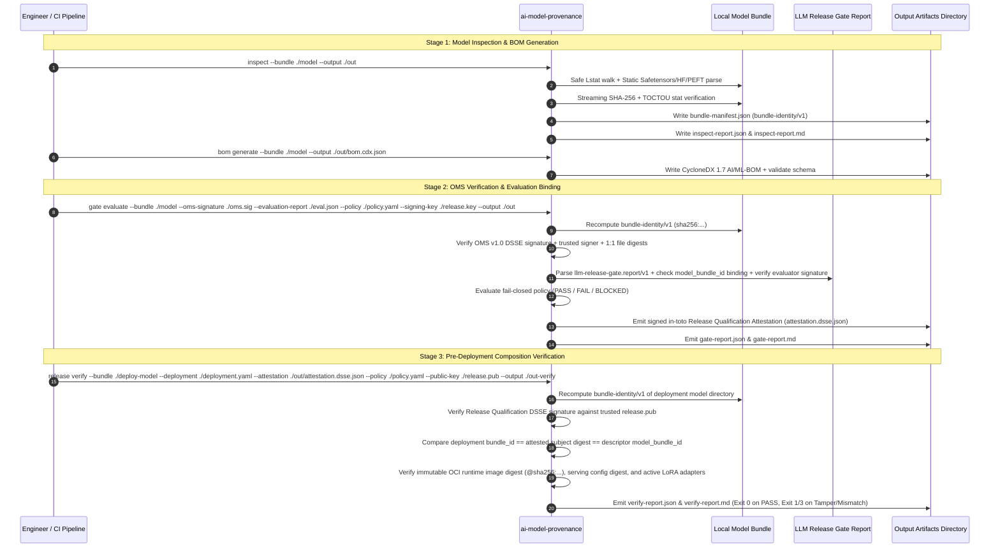

# System Data Flow

## 1. End-to-End Lifecycle Data Flow

---

## 2. Artifact Inputs and Outputs by Command

| Command | Primary Inputs | Primary Outputs |
|---|---|---|
| `inspect` | `--bundle <dir>` `[--base-bundle <dir>]` | `bundle-manifest.json` (`bundle-identity/v1`) `inspect-report.json` `inspect-report.md` |
| `bom generate` / `bom validate` | `--bundle <dir>` (or `--bom <file>`) | `bom.cdx.json` (CycloneDX 1.6/1.7 ML-BOM) |
| `oms sign` / `oms verify` | `--bundle <dir>` `--signature <oms.sig>` `--public-key <pub.pem>` (or `--private-key`) | `oms.sig.json` (OMS v1.0 DSSE/Sigstore bundle) `oms-report.json` |
| `evidence bind-eval` | `--bundle <dir>` `--evaluation-report <report.json>` `--private-key <eval.key>` | `evaluation-attestation.dsse.json` (`evaluation-evidence/v1`) |
| `gate evaluate` | `--bundle <dir>` `--policy <policy.yaml>` `[--oms-signature <oms.sig>]` `[--evaluation-report <report.json>]` `[--evaluation-attestation <eval.dsse.json>]` `[--scanner-report <scan.json>]` `[--signing-key <release.key>]` | `release-attestation.dsse.json` (`release-qualification/v1`) `bom.cdx.json` `bundle-manifest.json` `gate-report.json` `gate-report.md` |
| `release verify` | `--bundle <dir>` `--attestation <release-attestation.dsse.json>` `--policy <policy.yaml>` `[--deployment <deployment.yaml>]` `[--public-key <release.pub>]` | `deployment-manifest.json` (`deployment-composition/v1`) `verify-report.json` `verify-report.md` |
