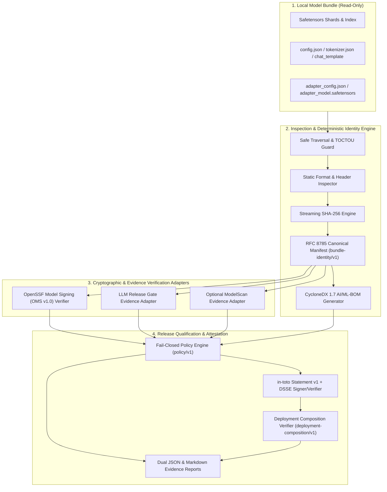

# Architecture Overview

## 1. Mission & Product Thesis

**AI Model Provenance Gate** (`ai-model-provenance-gate`) is a lightweight, CPU-only, Go-native CLI that enforces a single cryptographic supply-chain invariant:

> **The exact AI model artifact that was inspected, evaluated, signed, approved, and qualified must be the exact artifact verified for release and deployment.**

In modern AI/ML delivery pipelines, behavioral evaluation (`llm-release-gate`), infrastructure conformance (`ai-platform-conformance-kit`), and deployment are frequently decoupled by mutable directory paths, model registry tags, or unverified adapter references. A passing evaluation report for `"llama-3-support-v1"` does not prevent a modified tokenizer, a substituted LoRA adapter, a tampered `.safetensors` shard, or a mutable runtime container tag from reaching production unless every artifact and evidence source is cryptographically bound to a deterministic **Model Bundle Identity** (`bundle-identity/v1`) and verified at deployment composition time (`deployment-composition/v1`).

---

## 2. Portfolio Boundary & Responsibilities

| Repository | Layer | Responsibility |
|---|---|---|
| [`ai-platform-conformance-kit`](https://github.com/devenes/ai-platform-conformance-kit) | Infrastructure & Platform | Verifies cluster, runtime, hardware, network, and platform conformance. |
| [`llm-release-gate`](https://github.com/devenes/llm-release-gate) | Behavioral & Regression | Evaluates model behavior, prompt/response quality, latency, and baseline regressions. |
| **`ai-model-provenance-gate`** | **Artifact Identity, Provenance & Release Qualification** | Computes deterministic model bundle identities, generates CycloneDX AI/ML-BOMs, verifies OpenSSF Model Signing (OMS) signatures, cryptographically binds `llm-release-gate` evaluation evidence to the exact model bundle, issues signed in-toto Release Qualification Attestations, and verifies deployment composition prior to release. |

### Non-Goals
`ai-model-provenance-gate` is **not**:
- A model-serving runtime or inference gateway.
- A model registry or artifact storage service.
- A behavioral evaluation framework (delegated to `llm-release-gate`).
- A replacement for Sigstore/Cosign, CycloneDX, in-toto, or OpenSSF Model Signing.
- A general-purpose antivirus or malware scanner.
- A live Kubernetes operator or cluster controller in its initial release.

---

## 3. Core Subsystems

1. **Model Bundle Inspector & File Inventory (`internal/bundle`, `internal/inventory`, `internal/formats/*`)**:
   Performs symlink-rejecting, traversal-safe directory enumeration, static Safetensors binary header verification (without loading weights into memory or executing pickle/Python code), Hugging Face index cross-checking, and PEFT/LoRA relationship classification.
2. **Streaming SHA-256 Digest Engine (`internal/digest`)**:
   Streams arbitrary-sized weight files in bounded memory buffers while recording pre-read and post-read file size and modification timestamps to detect concurrent file mutation (TOCTOU) during hashing.
3. **Deterministic Model Bundle Identity (`internal/manifest`, `internal/identity`)**:
   Constructs the `bundle-identity/v1` manifest sorted by NFC-normalized POSIX relative path, serializes it via RFC 8785 JSON Canonicalization Scheme (JCS), and derives the canonical `model_bundle_id` (`sha256:<64-hex>`).
4. **CycloneDX AI/ML-BOM Generator & Validator (`internal/bom`)**:
   Produces a standards-compliant CycloneDX 1.6/1.7 `machine-learning-model` BOM distinguishing `observed` from `declared_unverified` metadata and validates it against the schema profile.
5. **OpenSSF Model Signing Integration (`internal/oms`)**:
   Verifies OMS v1.0 (`https://model_signing/signature/v1.0`) and v0.1 (`https://model_signing/digests/v0.1`) DSSE envelopes and Sigstore bundles against trusted public keys and enforces 1-to-1 file digest correspondence with the bundle inventory.
6. **LLM Release Gate Evidence Adapter (`internal/evaluation/llmreleasegate`)**:
   Ingests `llm-release-gate.report/v1` reports, validates schema integrity, enforces cryptographic binding (`candidate.metadata["model_bundle_id"]` and/or signed evaluation evidence attestation), and maps evaluation statuses without conflating unbound `PASS` reports with qualified artifacts.
7. **Fail-Closed Policy Engine (`internal/policy`)**:
   Evaluates all collected evidence against `policy/v1` (`strict` vs `permissive` with explicit auditable exceptions) and yields `PASS`, `FAIL`, `BLOCKED`, `NOT_RUN`, or `ERROR`.
8. **in-toto Release Qualification Attestation & DSSE Signing (`internal/attestation`, `internal/signing`, `internal/verification`)**:
   Produces and cryptographically signs/verifies `https://in-toto.io/Statement/v1` envelopes with predicate `release-qualification/v1`.
9. **Deployment Composition Verifier (`internal/deployment`)**:
   Verifies `deployment-composition/v1` descriptors binding the approved `model_bundle_id`, immutable OCI runtime image digest (`@sha256:...`), serving configuration digest, and active LoRA adapters against the signed release qualification attestation.
