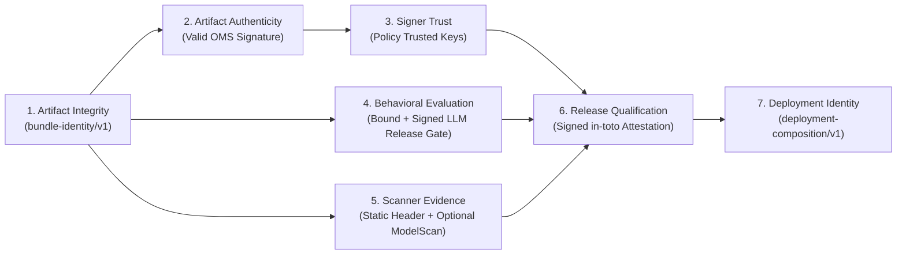

# Trust Model and Security Guarantees

## 1. Explicit Separation of Security Guarantees

A core design principle of `ai-model-provenance-gate` is that **no security signal may be treated as implicit proof of a different security property**.

### Guarantee Boundaries
1. **SHA-256 Digest $\neq$ Authenticity or Safety:**
   A deterministic `bundle_id` proves only that a set of files has a specific byte content. An attacker can compute a valid SHA-256 over a poisoned model.
2. **Valid CycloneDX AI/ML-BOM $\neq$ Authenticity:**
   A schema-valid BOM is an inventory document. Without a cryptographic signature from a trusted signer over the same file digests, a BOM is self-asserted metadata.
3. **Valid OMS Cryptographic Signature $\neq$ Signer Authorization or Behavioral Quality:**
   A mathematically valid DSSE signature proves only that the holder of the corresponding private key signed the manifest. Unless that public key fingerprint is present in `policy.signing.trusted_signers`, the signature status is `UNTRUSTED_SIGNER` and is rejected by strict policy. Furthermore, a trusted builder's signature does not prove the model passed regression/safety evaluation.
4. **Evaluation `PASS` $\neq$ Bound or Authentic Evaluation Evidence:**
   An `llm-release-gate` JSON report with `"gateStatus": "PASS"` proves nothing about a candidate model bundle unless:
   - The report explicitly binds the exact `model_bundle_id` (`binding_status == MATCHED`), AND
   - Under strict policy (`require_trusted_evidence: true`), the report's SHA-256 digest is signed by a trusted evaluation key (`trust_status == VERIFIED_TRUSTED`).
5. **Security Scanner `PASS` $\neq$ Behavioral Safety:**
   Static Safetensors header validation and ModelScan checks detect serialization exploits (e.g., arbitrary code execution via Python `pickle` opcodes or corrupt tensor offsets). They do not detect backdoored weights, jailbreak susceptibility, or hallucination regressions.
6. **Release Qualification $\neq$ Deployment Composition Integrity:**
   Approving a model bundle does not prevent a deployment pipeline from pairing that model with a mutable container tag (`vllm:latest`), an unapproved LoRA adapter, or altered serving parameters. Deployment verification (`release verify`) checks the complete `deployment-composition/v1` descriptor against policy and the signed release qualification attestation.

---

## 2. Trust Roots & Verification Material

All cryptographic verification in `ai-model-provenance-gate` is anchored in explicit, policy-declared trust roots:

1. **OMS Model Signer Trust Root (`policy.signing.trusted_signers`)**:
   - Each trusted signer entry specifies a human-readable `id`/`name`, a PEM public key path (`public_key_path`), and/or an expected PKIX public key SHA-256 fingerprint (`key_fingerprint: "sha256:<64-hex>"`) and optional `key_id`.
   - During verification, the public key is parsed, its canonical PKIX DER bytes are hashed with SHA-256, and both the cryptographic signature over the DSSE PAE and the key fingerprint against `trusted_signers` are verified.
2. **Evaluation Evidence Signer Trust Root (`policy.evaluation.trusted_signers`)**:
   - Verifies detached DSSE evaluation evidence attestations (`evaluation-evidence/v1`) binding `llm-release-gate` report digests to `model_bundle_id`.
3. **Release Qualification Signer Trust Root (`policy.release.trusted_signers` / `--public-key`)**:
   - Verifies the signed `release-qualification/v1` in-toto DSSE attestation during `release verify`.

---

## 3. Fail-Closed Decision State Machine

Every gate evaluation (`gate evaluate` and `release verify`) produces one of five unambiguous statuses and deterministic process exit codes:

| Status | Exit Code | Meaning |
|---|---|---|
| `PASS` | `0` | All required integrity, BOM, signature, signer trust, evaluation binding, scanner, and deployment checks passed with complete evidence. |
| `FAIL` | `1` | A cryptographic check, digest comparison, signer trust check, evaluation result (`FAIL`), artifact binding (`MISMATCH`), or policy rule failed. |
| `INVALID_INPUT` / `ERROR` | `2` / `4` | `2`: Malformed CLI flags, invalid YAML/JSON schema, or path violation. `4`: Unexpected internal runtime error. |
| `BLOCKED` | `3` | Required verification material is missing, evidence is `UNBOUND` or unsigned when trusted evidence is required, evaluation status is `BLOCKED`/`NOT_RUN`, or a required external tool is unavailable. |
| `NOT_RUN` | `3` | Execution was configured in dry-run/not-run mode. |
